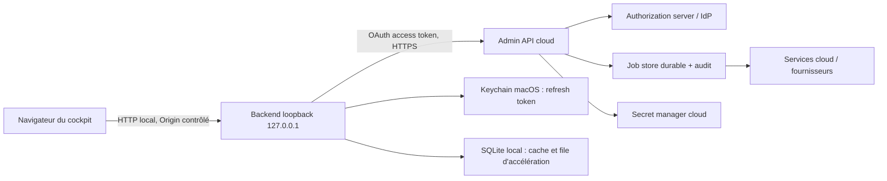

# Recherche — worker Mac et Admin API cloud

Date de consultation : 2026-08-17  
Périmètre : architecture `Browser -> localhost backend -> authenticated remote admin API -> cloud services`, avec reprise après extinction du Mac, fallback, cache et évolution vers l’accès distant.  
Nature : recherche documentaire et recommandations d’architecture ; aucun ticket ni code modifié.

## Conclusion courte

Pour le MVP, le choix le plus défendable est un cockpit local qui parle uniquement à un backend lié à `127.0.0.1`, lequel appelle une Admin API cloud. Le Mac est un client/worker non fiable et remplaçable ; le cloud garde la source de vérité, les jobs durables, les secrets fournisseurs, les autorisations et l’audit.

Le flux recommandé est OAuth 2.0 Authorization Code + PKCE pour un client natif/public, avec redirection loopback éphémère vers `127.0.0.1`. Aucun `client_secret` ne doit être distribué dans l’application Mac. Les access tokens restent en mémoire ; le refresh token, s’il est nécessaire, est conservé dans le Keychain macOS avec l’attribut d’accessibilité le plus restrictif compatible avec le besoin de reprise en arrière-plan.

Le mode hors ligne doit être limité à un affichage explicitement marqué comme possiblement obsolète. Les écritures sensibles, dépenses, publications, suppressions et rotations de credentials exigent une connexion au cloud et, lorsque le risque le justifie, une ré-authentification. Une extinction du Mac ne doit pas interrompre le service public ni perdre un job : le job doit être créé et suivi côté cloud, puis repris par un worker quand celui-ci revient.

## 1. Architectures comparées

| Variante | Intérêt | Risque ou limite | Verdict MVP |
|---|---|---|---|
| **Cockpit local + backend loopback + Admin API cloud** | Réduit l’exposition publique du cockpit ; permet de conserver une UX locale et un worker Mac. | Le poste local reste un environnement compromis possible ; il faut protéger le pont navigateur-local et réduire les privilèges des tokens. | **Recommandée**. |
| **Navigateur -> Admin API cloud directement** | Moins de composants locaux ; le cloud est naturellement disponible Mac éteint. | Les tokens et la logique d’administration se rapprochent du navigateur ; il faut une architecture web adaptée, notamment pour ne pas exposer de secrets de service. | Bonne cible pour un cockpit distant, ou pour des lectures simples ; pas nécessairement le meilleur premier découpage local. |
| **Worker Mac sortant vers un relay/control plane cloud** | Le cloud peut affecter des jobs au Mac sans ouvrir de port entrant ; prépare plusieurs workers et l’accès distant. | Introduit identité de worker, leasing, reconnexion, versionnement et observabilité. | **Évolution recommandée** quand le worker devient un composant durable. |
| **Port entrant/VPN/SSH directement vers le Mac** | Peut sembler rapide pour un prototype interne. | Expose une machine opérateur, complexifie la révocation et la posture réseau ; contredit l’idée de ne faire confiance ni à la localisation réseau ni à l’actif lui-même. | À éviter comme fondation produit. |

La préférence pour une identité et une autorisation au niveau des sujets, appareils et ressources plutôt qu’une confiance fondée sur le réseau est cohérente avec [NIST SP 800-207 — Zero Trust Architecture](https://csrc.nist.gov/pubs/sp/800/207/final). Le découpage « cloud control plane + agent/worker local » est ici une déduction d’architecture appliquée au projet, et non une prescription littérale de NIST.

### Schéma cible MVP



Le navigateur ne reçoit pas de credential fournisseur. Le backend local ne devient pas la source de vérité : il orchestre l’interface, garde éventuellement une file locale et transmet les commandes autorisées au cloud.

## 2. Authentification et autorisation

### 2.1 Flux d’installation et de connexion

1. Le backend local génère un `code_verifier` PKCE, un `state` aléatoire et ouvre le navigateur vers l’authorization endpoint.
2. Le client natif est enregistré comme **public client**. Il ne contient pas de secret partagé : [RFC 8252 §8.5](https://www.rfc-editor.org/rfc/rfc8252.html#section-8.5) précise qu’un secret distribué dans plusieurs installations d’une application native ne peut pas être considéré comme confidentiel.
3. Le backend écoute temporairement sur une adresse loopback, avec un port éphémère et un chemin de retour fixe. [RFC 8252 §7.3](https://www.rfc-editor.org/rfc/rfc8252.html#section-7.3) recommande la redirection loopback pour les applications desktop, l’écoute uniquement sur loopback et la fermeture du port après le retour.
4. Le backend échange le code contre des tokens en vérifiant `state`, le `code_verifier`, l’issuer et la redirection attendue.
5. L’Admin API vérifie au minimum l’issuer, l’audience, l’expiration, le type de token, le sujet, le tenant/projet et les scopes ; elle refait l’autorisation objet/action côté serveur.

[RFC 8252](https://www.rfc-editor.org/rfc/rfc8252.html) impose l’usage de PKCE pour les clients natifs publics et déconseille l’Implicit Grant. [RFC 9700](https://www.rfc-editor.org/rfc/rfc9700.html) renforce cette position, recommande des tokens à privilèges et audience restreints, ainsi que la protection contre le replay des refresh tokens.

Le **Device Authorization Grant** de [RFC 8628](https://www.rfc-editor.org/rfc/rfc8628.html) peut servir de parcours de secours pour un environnement sans navigateur local ou pour une installation opérée à distance. Il ne doit pas remplacer le flux navigateur/PKCE sur un Mac capable d’ouvrir un navigateur : RFC 8628 renvoie explicitement les applications natives capables de ce parcours vers RFC 8252.

### 2.2 Durée de vie et preuve de possession

- Access token court, uniquement en mémoire lorsque c’est possible ; scopes et audience minimaux, par exemple `admin:read`, `jobs:write`, `publish:approve` séparés plutôt qu’un rôle global.
- Refresh token dans le Keychain, rotation à chaque renouvellement et révocation côté authorization server. [RFC 9700 §4.14](https://www.rfc-editor.org/rfc/rfc9700.html#section-4.14) recommande pour les clients publics soit un token lié à l’instance, soit la rotation des refresh tokens ; le replay doit invalider la chaîne active.
- Si le fournisseur d’identité et l’API le supportent, évaluer [DPoP (RFC 9449)](https://www.rfc-editor.org/rfc/rfc9449.html) pour lier access/refresh tokens à une clé privée d’instance et réduire la valeur d’un token volé. C’est une évolution, pas une dépendance du MVP.
- MFA, ré-authentification et step-up pour les actions à fort impact : publication, achat de domaine, dépense, suppression, export massif, changement de secret.
- Révocation par utilisateur, par installation Mac et par worker ; le serveur doit pouvoir désactiver un appareil sans attendre l’expiration naturelle de tous ses tokens.

### 2.3 Pont navigateur -> localhost

Le fait qu’un endpoint écoute sur `localhost` ne constitue pas une autorisation. Le backend doit :

- se lier à `127.0.0.1`/`::1`, jamais à toutes les interfaces ;
- vérifier strictement `Origin` et `Host`, refuser les origines inattendues et ne pas activer un CORS `*` avec credentials ;
- utiliser une session locale courte et un mécanisme anti-CSRF si le navigateur utilise des cookies ;
- limiter les routes locales à l’interface nécessaire, avec validation de schéma, tailles et méthodes ;
- ne jamais accepter depuis le navigateur un token fournisseur, un secret cloud ou une URL arbitraire à appeler ;
- traiter les paramètres d’URL, uploads et callbacks comme des entrées non fiables afin d’éviter SSRF, exfiltration et exécution de commandes.

Ces contrôles sont des exigences d’ingénierie dérivées de la frontière de confiance ; ils complètent [OWASP API Security Top 10 2023](https://owasp.org/www-project-api-security/), notamment les risques de broken authentication, broken object-level authorization et unrestricted resource consumption.

## 3. Secrets et stockage local

### 3.1 Répartition recommandée

| Secret ou credential | Lieu recommandé | Présence sur le Mac |
|---|---|---|
| Mot de passe utilisateur | Authorization server/IdP | Jamais. |
| `client_secret` OAuth | Aucun pour le client natif public | Jamais distribué dans l’application. |
| Access token | Mémoire du backend local | Temporaire ; jamais dans les logs ni dans une base locale persistante. |
| Refresh token | Keychain macOS, entrée privée de l’application | Oui, protégé et révocable. |
| Clé DPoP éventuelle | Keychain/Secure Enclave selon faisabilité de la cible | Oui, idéalement non exportable. |
| Clés/API keys des fournisseurs | Secret manager cloud, utilisées par les services cloud | Jamais dans le cockpit ou le worker par défaut. |
| Cache métier et jobs locaux | SQLite local, sans secrets | Oui, données minimisées et purgées selon une politique. |

[Apple — Restricting keychain item accessibility](https://developer.apple.com/documentation/security/restricting-keychain-item-accessibility) recommande d’utiliser l’option la plus restrictive compatible avec le besoin. `kSecAttrAccessibleWhenUnlockedThisDeviceOnly` n’est accessible que lorsque le Mac est déverrouillé et ne migre pas vers un autre appareil ; un worker qui doit redémarrer en arrière-plan après le premier déverrouillage peut nécessiter une variante `AfterFirstUnlockThisDeviceOnly`, avec un compromis de sécurité à documenter. [Apple — kSecAttrAccessibleWhenUnlockedThisDeviceOnly](https://developer.apple.com/documentation/security/ksecattraccessiblewhenunlockedthisdeviceonly) confirme le comportement « appareil déverrouillé » et « appareil uniquement ».

Le Keychain protège l’accès au secret au repos, mais ne protège pas un Mac déjà compromis ou un processus exécuté avec les mêmes privilèges au moment où le backend utilise le token. Il faut donc réduire l’audience, les scopes, la durée de vie et la capacité de révocation. La séparation des app access groups doit rester minimale ; [Apple — Keychain access groups](https://developer.apple.com/documentation/security/sharing-access-to-keychain-items-among-a-collection-of-apps) indique que le partage s’appuie sur des groupes d’accès associés au code signing.

### 3.2 Secret manager cloud

Les secrets fournisseurs sont des dépendances d’exécution du cloud, pas des paramètres de confort du cockpit. Le service qui en a besoin reçoit uniquement le secret ou la permission correspondant à son rôle ; les secrets sont séparés par environnement, fournisseur et capacité. La rotation, l’expiration, la révocation, l’accès et les échecs sont audités.

[OWASP Secrets Management Cheat Sheet](https://cheatsheetseries.owasp.org/cheatsheets/Secrets_Management_Cheat_Sheet.html) recommande least privilege, rotation automatisable, expiration, révocation, audit et absence de secrets en clair dans les logs. [OWASP Logging Cheat Sheet](https://cheatsheetseries.owasp.org/cheatsheets/Logging_Cheat_Sheet.html) cite explicitement les access tokens, mots de passe, chaînes de connexion et clés de chiffrement parmi les données à ne pas enregistrer directement.

La perte ou suspicion de compromission doit avoir un chemin opérable : désactiver l’installation/worker, révoquer les refresh tokens, faire tourner le secret fournisseur, invalider les caches concernés, puis vérifier les événements d’audit. [NIST SP 800-57 Part 1 Rev. 5](https://csrc.nist.gov/pubs/sp/800/57/pt1/r5/final) traite notamment les états de clé, la compromission, la révocation et la gestion de cycle de vie.

## 4. Reprise après extinction, crash ou perte réseau

### 4.1 Source de vérité et modèle de job

Le cloud doit persister avant réponse au cockpit :

```text
Job = id + type + payload validé + idempotency_key + status + version
      + attempts + lease/worker_id + next_attempt_at + audit_refs
```

Le worker Mac ne doit jamais considérer « requête HTTP envoyée » comme « job terminé ». Le protocole doit distinguer au moins `accepted`, `leased`, `running`, `succeeded`, `failed_retryable`, `failed_terminal`, `cancelled` et `unknown/reconcile`.

Après redémarrage :

1. ouvrir le stockage local et réparer/rejouer les transactions incomplètes ;
2. rafraîchir l’identité si le Keychain le permet, sinon demander une reconnexion ;
3. envoyer un heartbeat/reconnect et récupérer les jobs attribués ou expirés ;
4. réconcilier chaque job local avec l’état cloud par `job_id`, version et `idempotency_key` ;
5. reprendre seulement les jobs dont le lease est acquis et dont la politique l’autorise ;
6. marquer les résultats ambigus pour réconciliation humaine ou serveur, jamais comme succès automatique.

Une base SQLite convient comme file/cache local si elle est utilisée transactionnellement : la documentation SQLite explique que ses transactions sont atomiques face au crash ou à la coupure d’alimentation et que le journal de rollback permet une récupération automatique ([Atomic Commit In SQLite](https://www2.sqlite.org/atomiccommit.html), [SQLite file format — rollback journal](https://www.sqlite.org/fileformat.html)). Cela ne rend pas les effets externes idempotents : l’idempotence et la déduplication doivent être garanties par l’Admin API et/ou le fournisseur.

### 4.2 Relance du processus

`launchd` peut maintenir ou relancer un agent local. La documentation Apple décrit `KeepAlive`, tout en recommandant de concevoir les jobs pour être lancés à la demande lorsque c’est possible ([Creating Launch Daemons and Agents](https://developer.apple.com/library/archive/documentation/MacOSX/Conceptual/BPSystemStartup/Chapters/CreatingLaunchdJobs.html)). `KeepAlive` est donc un mécanisme de disponibilité locale, pas une garantie de disponibilité produit : le cloud doit fonctionner et continuer à recevoir les demandes Mac éteint.

Pour les erreurs transitoires : backoff exponentiel borné avec jitter, respect de `Retry-After`, plafond d’essais et circuit breaker. [RFC 6585 §4](https://www.rfc-editor.org/rfc/rfc6585.html#section-4) définit `429 Too Many Requests` et permet au serveur d’indiquer `Retry-After`; les réponses `429` ne doivent pas être stockées par un cache. Aucun retry aveugle d’une opération non idempotente.

### 4.3 Ce qui doit continuer Mac éteint

- réception publique des demandes ;
- persistance des `SiteSpec`, prospects, paiements, domaines, états de workflow et audits ;
- planification et retries côté cloud ;
- expirations et révocations de credentials ;
- éventuellement les étapes pouvant s’exécuter dans des workers cloud.

Ce qui peut attendre le retour du Mac : une tâche explicitement affectée au worker local, une action de développement ou une étape nécessitant un outil installé uniquement sur ce poste. L’interface doit distinguer « en attente du worker » de « panne du système ».

## 5. Fallback et cache

### 5.1 Cache de lecture

Le cache local doit être un **cache d’accélération**, jamais une source d’autorité :

- stocker des vues minimisées : listes, statuts, timestamps, versions, identifiants ;
- afficher `last_synced_at`, l’âge et un indicateur « potentiellement obsolète » ;
- privilégier validation par ETag/version et invalidation après mutation confirmée ;
- ne pas mettre en cache localement les tokens, secrets fournisseurs, réponses contenant des credentials ou données excessivement sensibles ;
- utiliser `Cache-Control: no-store` pour les réponses qui ne doivent pas être stockées. [RFC 9111 §5.2.1.5](https://www.rfc-editor.org/rfc/rfc9111.html#section-5.2.1.5) définit `no-store` comme l’interdiction de stocker intentionnellement la requête ou la réponse en stockage non volatil ;
- si un mode stale est choisi, limiter par type de ressource et durée. [RFC 5861](https://www.rfc-editor.org/rfc/rfc5861.html) décrit `stale-while-revalidate` et `stale-if-error`, mais ne transforme pas une réponse obsolète en autorisation d’écriture.

### 5.2 Fallback fonctionnel

| Situation | Comportement sûr |
|---|---|
| Cloud indisponible, cache récent | Afficher les lectures avec âge ; bloquer les écritures sensibles. |
| Cloud indisponible, cache ancien | Afficher l’état ancien clairement ou seulement l’écran de panne ; ne pas le présenter comme actuel. |
| Token expiré mais refresh possible | Refresh unique verrouillé ; reprise de la requête une seule fois si elle est sûre et idempotente. |
| Refresh rejeté/révoqué | Effacer la session locale, demander reconnexion ; ne pas boucler. |
| Job soumis mais réponse perdue | Rechercher par `idempotency_key`/`job_id` avant de recréer. |
| Échec provider | Conserver l’état `retryable` ou `terminal` côté cloud, avec raison non secrète et audit. |
| Action destructive hors ligne | Refuser ; connexion et autorisation serveur obligatoires. |

Le fallback ne doit pas « simuler » une réussite. Pour une commande concurrente, le serveur peut exiger une version courante ou une requête conditionnelle ; [RFC 6585 §3](https://www.rfc-editor.org/rfc/rfc6585.html#section-3) formalise `428 Precondition Required` pour les requêtes qui doivent être conditionnelles.

## 6. Évolution vers l’accès distant

### Étape A — MVP local

- opérateur sur le Mac ;
- navigateur et backend loopback ;
- Admin API cloud unique ;
- secrets fournisseurs uniquement côté cloud ;
- worker Mac optionnel, sans port entrant ;
- jobs cloud durables et cache local lisible hors ligne.

### Étape B — Worker enregistré

Introduire une ressource `Worker` côté cloud : `worker_id`, installation, version, capacités, dernière présence, statut de révocation, scopes propres et clé d’instance. Le worker ouvre une connexion sortante ou effectue du polling ; le cloud attribue des jobs par lease. Un worker ne reçoit que les jobs de ses capacités et ne peut pas appeler l’API d’administration générale avec une identité utilisateur illimitée.

### Étape C — Cockpit distant

Le navigateur distant s’authentifie auprès du même IdP et appelle l’Admin API via un gateway/API policy enforcement point. Il ne se connecte pas au `localhost` d’un Mac et ne reçoit pas les credentials du worker. Le Mac reste un exécuteur sortant ; le cloud conserve les événements, l’autorisation, l’audit et la reprise.

Cette direction suit l’idée NIST d’un point d’enforcement qui contrôle et peut terminer les chemins vers les ressources, ainsi que d’une authentification/autorisation dynamique avant accès ([NIST SP 800-207](https://csrc.nist.gov/pubs/sp/800/207/final)). L’association « worker sortant + relay cloud » est une recommandation de conception pour éviter l’exposition entrante, à valider selon les exigences réseau réelles.

### Étape D — Accès opérationnel exceptionnel

Si un accès terminal ou bureau distant est nécessaire plus tard, il doit être brokerisé par le cloud : session courte, approbation explicite, capacité limitée, enregistrement/audit, révocation immédiate et séparation des rôles. Il ne faut pas réutiliser le refresh token opérateur comme credential de machine ni transformer le worker en bastion réseau général.

## 7. Contrat minimal à décider avant implémentation

1. **Identité** : fournisseur OAuth/OIDC, issuer, audiences, scopes, MFA et politiques de step-up.
2. **Installation** : application native publique ou backend local distribué, flux PKCE loopback et stratégie de reconnexion.
3. **Secrets** : secret manager cloud retenu, propriétaires, rotation, révocation et procédure d’incident.
4. **Jobs** : états, idempotency keys, lease/heartbeat, timeout, limites de retry et réconciliation d’effets externes.
5. **Offline** : types de ressources cachables, TTL, données exclues, actions refusées hors ligne et libellé de fraîcheur.
6. **Worker** : capacités, identité par installation, version minimale, mise à jour, révocation et comportement Mac éteint.
7. **Audit** : corrélation `actor_id`, `worker_id`, `job_id`, `request_id`, résultat et raison ; aucun token/secret dans les logs.
8. **Menaces** : Mac compromis, session navigateur compromise, API cloud abusée, fournisseur indisponible, doublon après timeout, replay de token, SSRF et exfiltration de logs.

## Sources consultées

- [RFC 8252 — OAuth 2.0 for Native Apps](https://www.rfc-editor.org/rfc/rfc8252.html), loopback, PKCE, clients publics et absence de `client_secret` fiable dans une application distribuée.
- [RFC 9700 — Best Current Practice for OAuth 2.0](https://www.rfc-editor.org/rfc/rfc9700.html), PKCE, rotation/replay des refresh tokens, scopes/audiences et TLS.
- [RFC 6749 — OAuth 2.0 Authorization Framework](https://www.rfc-editor.org/rfc/rfc6749.html), rôles, tokens, scopes et confidentialité des tokens en transit et au repos.
- [RFC 8628 — OAuth 2.0 Device Authorization Grant](https://www.rfc-editor.org/rfc/rfc8628.html), parcours de secours sans navigateur approprié.
- [RFC 9449 — OAuth 2.0 DPoP](https://www.rfc-editor.org/rfc/rfc9449.html), sender-constrained access/refresh tokens.
- [Apple — Restricting keychain item accessibility](https://developer.apple.com/documentation/security/restricting-keychain-item-accessibility) et [kSecAttrAccessibleWhenUnlockedThisDeviceOnly](https://developer.apple.com/documentation/security/ksecattraccessiblewhenunlockedthisdeviceonly), protection et migration des items Keychain.
- [Apple — Sharing access to keychain items among a collection of apps](https://developer.apple.com/documentation/security/sharing-access-to-keychain-items-among-a-collection-of-apps), access groups et isolement par défaut.
- [Apple — Preventing insecure network connections](https://developer.apple.com/documentation/security/preventing-insecure-network-connections), ATS/TLS et validation serveur côté plateformes Apple.
- [Apple — Creating Launch Daemons and Agents](https://developer.apple.com/library/archive/documentation/MacOSX/Conceptual/BPSystemStartup/Chapters/CreatingLaunchdJobs.html), `launchd` et `KeepAlive`.
- [OWASP Secrets Management Cheat Sheet](https://cheatsheetseries.owasp.org/cheatsheets/Secrets_Management_Cheat_Sheet.html), least privilege, rotation, expiration, révocation et audit.
- [OWASP Logging Cheat Sheet](https://cheatsheetseries.owasp.org/cheatsheets/Logging_Cheat_Sheet.html), événements d’authentification et données à exclure des logs.
- [OWASP API Security Project / Top 10 2023](https://owasp.org/www-project-api-security/), risques d’authentification, d’autorisation objet et d’abus de ressources.
- [NIST SP 800-207 — Zero Trust Architecture](https://csrc.nist.gov/pubs/sp/800/207/final), absence de confiance implicite fondée sur la localisation réseau, identité et enforcement dynamique.
- [NIST SP 800-57 Part 1 Rev. 5](https://csrc.nist.gov/pubs/sp/800/57/pt1/r5/final), cycle de vie, compromission et révocation des clés.
- [RFC 9111 — HTTP Caching](https://www.rfc-editor.org/rfc/rfc9111.html), `no-store`, fraîcheur et limites du cache.
- [RFC 5861 — HTTP Cache-Control Extensions for Stale Content](https://www.rfc-editor.org/rfc/rfc5861.html), `stale-while-revalidate` et `stale-if-error`.
- [RFC 6585 — Additional HTTP Status Codes](https://www.rfc-editor.org/rfc/rfc6585.html), `428 Precondition Required`, `429 Too Many Requests` et `Retry-After`.
- [SQLite — Atomic Commit](https://www2.sqlite.org/atomiccommit.html) et [SQLite file format](https://www.sqlite.org/fileformat.html), récupération transactionnelle après crash/coupure.

